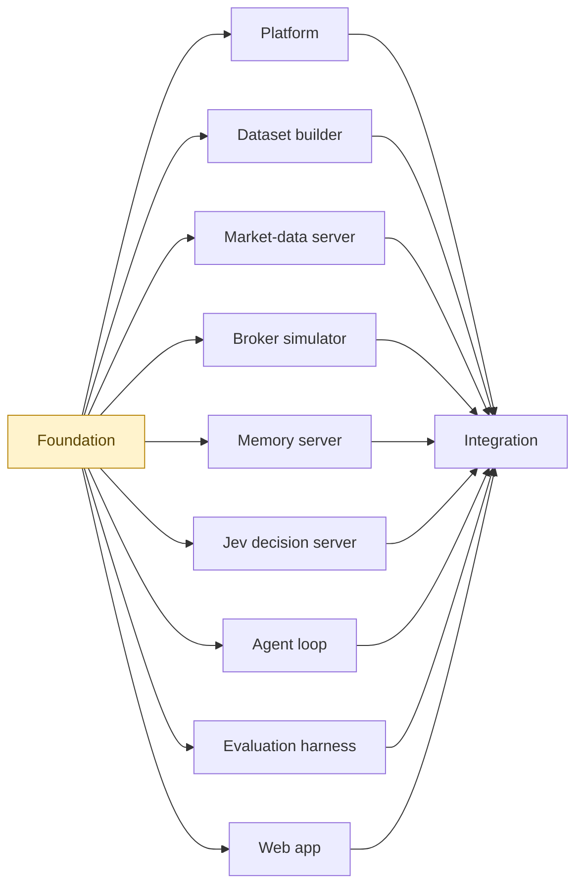

# Roadmap

Trading agent with memory, in simulation. The full specification is
[project-breakdown.md](project-breakdown.md). The work is split into 11
features with 60 steps in all. Each feature has its own index, its own long-lived
branch off `main`, and one file per step.

| Feature | Status | Steps | Needs in `main` | Index | Summary |
| --- | --- | --- | --- | --- | --- |
| Foundation | in progress | 2 of 7 | nothing | [foundation/ROADMAP.md](foundation/ROADMAP.md) | Repo scaffold, verified technology choices, shared contracts, fakes, Snowflake objects and stub services. |
| Platform | todo | 0 of 3 | foundation | [platform/ROADMAP.md](platform/ROADMAP.md) | Container images, the kind cluster, Kubernetes Terraform and the real job launcher. |
| Dataset builder | todo | 0 of 8 | foundation | [dataset-builder/ROADMAP.md](dataset-builder/ROADMAP.md) | Turns chosen assets and a date range into an immutable, masked simulation dataset with candle features. |
| Market-data server | todo | 0 of 2 | foundation | [market-data/ROADMAP.md](market-data/ROADMAP.md) | MCP server that serves snapshots, bars and instruments from a dataset, never past the current step. |
| Broker simulator | todo | 0 of 4 | foundation | [broker-sim/ROADMAP.md](broker-sim/ROADMAP.md) | MCP server that simulates fills, costs, margin and stops for every instrument type. |
| Memory server | todo | 0 of 6 | foundation | [memory/ROADMAP.md](memory/ROADMAP.md) | MCP server for the playbook, episodes with RAG search, the track record and position journals. |
| Jev decision server | todo | 0 of 3 | foundation | [jev-decision/ROADMAP.md](jev-decision/ROADMAP.md) | MCP server that asks Jev to screen, manage and decide, with a plain LLM fallback. |
| Agent loop | todo | 0 of 6 | foundation | [agent/ROADMAP.md](agent/ROADMAP.md) | The LangGraph agent: three-tier loop per step, risk gate, sizing, tracing and resumable runner. |
| Evaluation harness | todo | 0 of 3 | foundation | [evaluation/ROADMAP.md](evaluation/ROADMAP.md) | Metrics, baseline strategies and the one-command comparison of all variants. |
| Web app | todo | 0 of 8 | foundation | [web-app/ROADMAP.md](web-app/ROADMAP.md) | FastAPI backend and the editorial-ui frontend: dataset builder, live runs and analysis screens. |
| Integration | todo | 0 of 10 | per step; all features by the end | [integration/ROADMAP.md](integration/ROADMAP.md) | Real servers, real data and real models joined in the cluster, with the end-to-end and regression suites. |

## How the features depend on each other

Progress (2026-11-10): Foundation in progress (S0 and S1 done; S2 and S4 next). No feature done yet.

The build order is contract-first, chosen to maximise parallel work (decision PRJ-001):

1. **Foundation** fixes the shared contracts and ships fakes and stub servers. It is the
   only feature everything waits on, so it is kept small.
2. **Nine features run side by side** once foundation is in `main`. Each replaces a fake
   or a stub behind an interface that is already fixed, and is tested on the fixture
   dataset, so none of them waits for another. Up to nine agents can work at once, one
   per feature, and most features also have parallel steps inside them.
3. **Integration** joins them in the cluster on real data and real models. Its steps
   start as soon as the features each one needs are in `main`.

## Rules across features

- A feature starts only when the features in its "Needs in `main`" column are merged.
  Merging a feature branch into `main` needs the author's authorization.
- Agents on different features never edit each other's folders. The shared files are
  `shared/` (contracts), `requirements.txt`, `.env.example`, `README.md` and
  `docs/DECISIONS.md`.
- A contract change after foundation is additive only (new optional field, new method),
  is noted in the step's "What was done" and logged in `docs/DECISIONS.md`. A breaking
  change stops and goes to the author, because it affects every running feature.
- `docs/DECISIONS.md` has one heading per feature and IDs carry the feature prefix, so
  parallel branches append in different places and merge cleanly.
- A feature branch that needs something merged to `main` after it branched takes it by
  merging `main` into the feature branch, never by rebasing.
- Update this file's status and step count whenever a feature's index changes.
