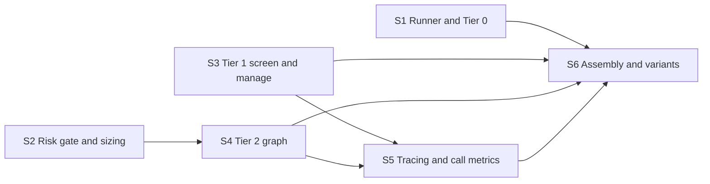

# Agent loop roadmap

The agent itself (spec sections 9, 11.2, 12.3 and 15): at every 15-minute step it may act
or do nothing, and every step is logged as a decision.

**Why it can run in parallel:** it reaches data, broker, memory and Jev only through the
tool interfaces, so it is built and tested entirely on the foundation's fakes and
scripted model responders. Real servers and real models arrive in integration.

**Architecture summary:** three tiers control cost. Tier 0 is code on every step:
advance the broker, enforce stops and limits, settle trades, update outcomes. Tier 1 is
Jev only: a yes/no screen per flat asset and a manage call per open position. Tier 2 is
the full LangGraph evaluation (observe, retrieve, propose, decide, gate, act, record),
run only when a pattern fired, the screen said yes, or manage answered 'add'. The LLM
proposes; Jev picks and sizes; code has the final say. Provider and model are one config
setting; prompts are versioned files.

**Branch:** `agent`, off `main`. **Needs in `main` first:** foundation.

S1 to S4 are four separate modules and start together; S5 and S6 join them.

Spec: [project breakdown](../project-breakdown.md). All features: [docs/ROADMAP.md](../ROADMAP.md).

## Dependency graph

Progress (2026-11-10): nothing done and nothing ready. Ready the moment foundation is merged into `main`: S1, S2, S3.

## Dependency table

"In `main`" entries are other features that must be merged before the step can start.

| Step | Depends on | Can run in parallel with | Main files touched |
| --- | --- | --- | --- |
| S1 Runner and Tier 0 | none | S2, S3, S4, S5 | `agent/runner.py`, `agent/tier0.py` |
| S2 Risk gate and sizing | none | S1, S3 | `agent/policy.py`, `agent/sizing.py` |
| S3 Tier 1 screen and manage | none | S1, S2, S4 | `agent/tier1.py` |
| S4 Tier 2 graph | S2 | S1, S3 | `agent/graph.py`, `agent/nodes/`, `prompts/` |
| S5 Tracing and call metrics | S3, S4 | S1 | `agent/observability.py` |
| S6 Assembly and variants | S1, S3, S4, S5 | none | `agent/runner.py`, `agent/__main__.py` |

## Steps

| Step | Status | File | Summary |
| --- | --- | --- | --- |
| S1 Runner and Tier 0 | todo | [S01-runner-and-tier-0.md](S01-runner-and-tier-0.md) | The replay loop over the shared clock that advances the broker, settles stops and closed trades, writes outcomes, logs a decision for every asset at every step, enforces a call budget and resumes from the last completed step. |
| S2 Risk gate and sizing | todo | [S02-risk-gate-and-sizing.md](S02-risk-gate-and-sizing.md) | Plain-code position, exposure and daily-loss limits with the final say on every order, plus bucket building and the probability-weighted dollar size rounded down to whole units. |
| S3 Tier 1 screen and manage | todo | [S03-tier-1-screen-and-manage.md](S03-tier-1-screen-and-manage.md) | The per-asset Jev screen and per-position manage call, the handling of hold, close, reduce and add, journal updates, and the rules that trigger a full evaluation. |
| S4 Tier 2 graph | todo | [S04-tier-2-graph.md](S04-tier-2-graph.md) | The LangGraph full evaluation: observe, retrieve with memory on or off, propose up to five candidates through tools, decide, gate, act and record, with the principles in a versioned system prompt. |
| S5 Tracing and call metrics | todo | [S05-tracing-and-call-metrics.md](S05-tracing-and-call-metrics.md) | LangSmith traces with run metadata for every full evaluation and one grouped trace per step for Tier 1, the trace ID saved on the episode, and tokens, cost, latency and retries recorded per call. |
| S6 Assembly and variants | todo | [S06-assembly-and-variants.md](S06-assembly-and-variants.md) | The three tiers wired into the runner over MCP clients, the memory-off and memory-on variants, and a five-day fixture backtest that completes on scripted models with no real name in any model input. |
