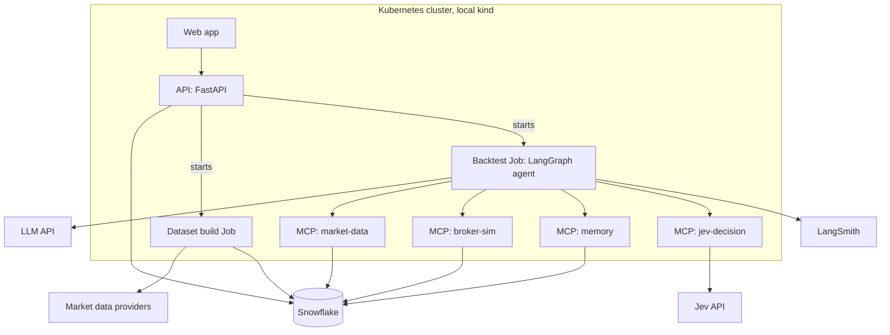

# Architecture

The full specification is [project-breakdown.md](project-breakdown.md); this file is the
short map of how the system fits together and where each part lives in the repo.

## System overview

A LangGraph agent replays a historical market in 15-minute steps. At each step it reaches
market data, a simulated broker, its long-term memory and the Jev decision model only
through four custom MCP servers. Everything persists in Snowflake. A FastAPI service
starts dataset builds and backtests as Kubernetes Jobs, and a web app drives it.

## Package map

The repo root is on the import path; there is no installable package (decision FND-003).

| Path | What lives there | Owned by feature |
| --- | --- | --- |
| `shared/` | Contracts every feature imports: Pydantic schemas, typed interfaces, the step clock, the config model, and in-memory fakes in `shared/fakes/` | foundation |
| `agent/` | LangGraph graph, nodes, sizing policy and the resumable runner | agent |
| `prompts/` | System prompts, one file per agent; changes noted in `docs/PROMPTS.md` | agent, jev-decision |
| `mcp_servers/market_data/` | Snapshots, bars and instruments, never past the current step | market-data |
| `mcp_servers/broker_sim/` | Fills, costs, margin and stops for every instrument type | broker-sim |
| `mcp_servers/memory/` | Playbook, episodes with RAG search, track record, position journals | memory |
| `mcp_servers/jev_decision/` | Screen, manage and decide through Jev, with a plain LLM fallback | jev-decision |
| `dataset_builder/` | Providers, validation, masking, candle features, build and publish | dataset-builder |
| `playbook/` | Playbook seed data | memory |
| `eval/` | Metrics, baseline strategies and the comparison command | evaluation |
| `api/` | FastAPI backend | web-app |
| `web/` | Frontend | web-app |
| `infra/terraform/` | `snowflake/` and `kubernetes/` modules | foundation, platform |
| `infra/sql/migrations/` | Versioned table migrations | foundation |
| `infra/docker/` | Container images | platform |
| `scripts/` | Command-line helpers (migrations, setup) | several |
| `tests/` | `unit/`, `replay/` and `behavior/` suites | every feature |

Two departures from the spec's section 20 layout (decision PRJ-005): this file replaces
a root `ARCHITECTURE.md`, and prompts live in a top-level `prompts/` rather than
`agent/prompts/`. `shared/` is added by decision PRJ-002.
