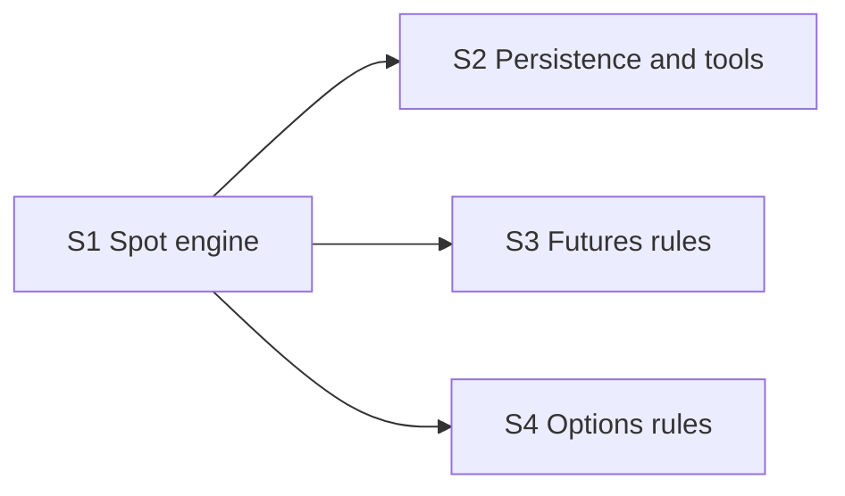

# Broker simulator roadmap

The `broker-sim` MCP server (spec section 10.2): the only place where orders become
fills. No real order is ever placed.

**Why it can run in parallel:** it replaces the stub from foundation behind the same
interface, and its core is pure arithmetic over bars.

**Architecture summary:** a pure engine with no I/O holds the account and applies the
simulation rules: orders placed at a bar's close fill at the next bar's open with
slippage and costs, positions are valued every step, and code closes a position when its
stop is hit. A thin layer adds the four tools, the step-advance operation the runner
calls, and persistence to the `SIM` tables. Futures and options are separate rule
modules added on top of the spot engine.

**Branch:** `broker-sim`, off `main`. **Needs in `main` first:** foundation.

After S1, the three remaining steps run in parallel.

Spec: [project breakdown](../project-breakdown.md). All features: [docs/ROADMAP.md](../ROADMAP.md).

## Dependency graph

Progress (2026-11-10): nothing done and nothing ready. Ready the moment foundation is merged into `main`: S1.

## Dependency table

"In `main`" entries are other features that must be merged before the step can start.

| Step | Depends on | Can run in parallel with | Main files touched |
| --- | --- | --- | --- |
| S1 Spot engine | none | none | `mcp_servers/broker_sim/engine/` |
| S2 Persistence and tools | S1 | S3, S4 | `mcp_servers/broker_sim/store.py`, `mcp_servers/broker_sim/tools.py` |
| S3 Futures rules | S1 | S2, S4 | `mcp_servers/broker_sim/engine/futures.py` |
| S4 Options rules | S1 | S2, S3 | `mcp_servers/broker_sim/engine/options.py` |

## Steps

| Step | Status | File | Summary |
| --- | --- | --- | --- |
| S1 Spot engine | todo | [S01-spot-engine.md](S01-spot-engine.md) | A pure simulation engine for stocks and crypto, long and short: dollar-to-unit conversion, next-bar fills with slippage and fees, margin and daily short fees, per-step valuation and code-enforced stops. |
| S2 Persistence and tools | todo | [S02-persistence-and-tools.md](S02-persistence-and-tools.md) | The four broker tools and the step-advance operation over the engine, with trades and per-step portfolio rows stored in Snowflake and account state rebuilt after a restart. |
| S3 Futures rules | todo | [S03-futures-rules.md](S03-futures-rules.md) | Micro futures with contract multiplier, per-contract margin, valuation every step and a roll to the next front contract before expiry. |
| S4 Options rules | todo | [S04-options-rules.md](S04-options-rules.md) | Long single calls and puts bought at the ask and sold at the bid, with premium as the dollar amount and expired contracts settled at their final value. |
