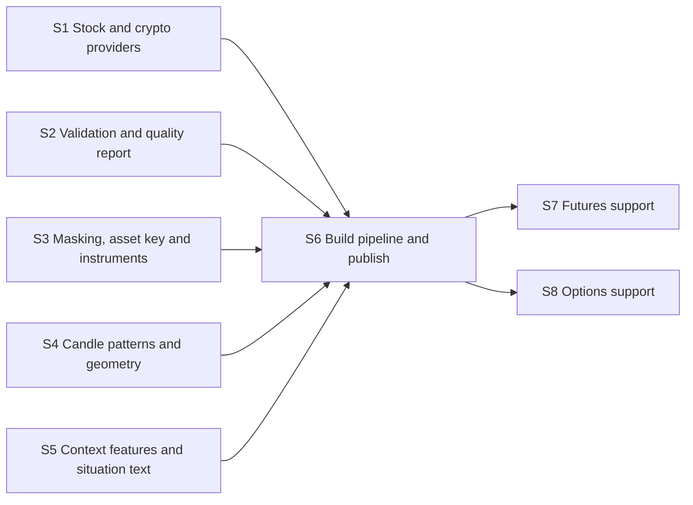

# Dataset builder roadmap

A standalone service that turns a list of assets and a date range into a ready-to-run
simulation dataset: download, validate, mask, compute candle features, publish
(spec sections 8 and 12.1).

**Why it can run in parallel:** it only writes the dataset tables defined in foundation.
Every consumer (market-data, broker, agent) develops against the fixture dataset until a
real one exists.

**Architecture summary:** five independent pieces feed one pipeline. Providers sit
behind one small interface per asset class. Validation, masking and the two candle
modules are pure functions over data frames, so they are built and tested side by side
on the fixture data. The pipeline step joins them and publishes under a new
`dataset_id`; a published dataset never changes. Futures and options are added last as
two parallel steps.

**Branch:** `dataset-builder`, off `main`. **Needs in `main` first:** foundation.

Shared file inside this feature: the pipeline module is edited by S6, S7 and S8.

Spec: [project breakdown](../project-breakdown.md). All features: [docs/ROADMAP.md](../ROADMAP.md).

## Dependency graph

Progress (2026-11-10): nothing done and nothing ready. Ready the moment foundation is merged into `main`: S1, S2, S3, S4, S5.

## Dependency table

"In `main`" entries are other features that must be merged before the step can start.

| Step | Depends on | Can run in parallel with | Main files touched |
| --- | --- | --- | --- |
| S1 Stock and crypto providers | none | S2, S3, S4, S5 | `dataset_builder/providers/` |
| S2 Validation and quality report | none | S1, S3, S4, S5 | `dataset_builder/validate.py` |
| S3 Masking, asset key and instruments | none | S1, S2, S4, S5 | `dataset_builder/mask.py`, `dataset_builder/instruments.py` |
| S4 Candle patterns and geometry | none | S1, S2, S3, S5 | `dataset_builder/candles/patterns.py`, `dataset_builder/candles/geometry.py` |
| S5 Context features and situation text | none | S1, S2, S3, S4 | `dataset_builder/candles/context.py`, `dataset_builder/candles/situation.py` |
| S6 Build pipeline and publish | S1, S2, S3, S4, S5 | none | `dataset_builder/build.py`, `dataset_builder/store.py`, `dataset_builder/__main__.py` |
| S7 Futures support | S6 | S8 | `dataset_builder/providers/futures.py`, `dataset_builder/instruments.py` |
| S8 Options support | S6 | S7 | `dataset_builder/providers/options.py`, `dataset_builder/instruments.py` |

## Steps

| Step | Status | File | Summary |
| --- | --- | --- | --- |
| S1 Stock and crypto providers | todo | [S01-stock-and-crypto-providers.md](S01-stock-and-crypto-providers.md) | One small provider interface per asset class, with a stock provider and a crypto provider that download 15-minute bars within rate limits, and asset search by name or ticker. |
| S2 Validation and quality report | todo | [S02-validation-and-quality-report.md](S02-validation-and-quality-report.md) | Checks for missing, duplicate and zero-volume bars and split-driven price jumps, split adjustment, and a quality report per build. |
| S3 Masking, asset key and instruments | todo | [S03-masking-asset-key-and-instruments.md](S03-masking-asset-key-and-instruments.md) | Random masked IDs, day numbers in place of dates, prices rescaled so each series starts at 100, the asset key with scale factors, and the spot instrument list. |
| S4 Candle patterns and geometry | todo | [S04-candle-patterns-and-geometry.md](S04-candle-patterns-and-geometry.md) | Every playbook pattern detected per bar through TA-Lib plus custom tweezer detectors, and candle geometry for the last eight bars, each checked against hand-built bars. |
| S5 Context features and situation text | todo | [S05-context-features-and-situation-text.md](S05-context-features-and-situation-text.md) | Trend, relative volume, VWAP and level distances, ATR and bar-in-day for every bar, the normalised feature vector, and the one-paragraph situation text. |
| S6 Build pipeline and publish | todo | [S06-build-pipeline-and-publish.md](S06-build-pipeline-and-publish.md) | The end-to-end build that downloads, validates, masks, computes features and publishes an immutable dataset with its development and test split, runnable from the command line. |
| S7 Futures support | todo | [S07-futures-support.md](S07-futures-support.md) | Micro futures front-contract bars with roll dates, and futures instrument rows with multiplier, margin and expiry, added to builds. |
| S8 Options support | todo | [S08-options-support.md](S08-options-support.md) | Quotes with implied volatility and Greeks for a filtered set of contracts, and option instrument rows with strike, expiry and type, added to builds. |
