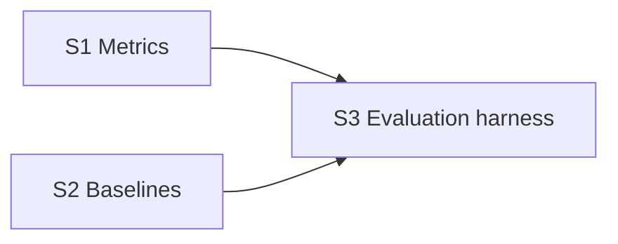

# Evaluation harness roadmap

The evaluation harness (spec section 17): it answers the project's main question, net
profit in dollars after all costs on a period the agent never saw, and whether memory
helps.

**Why it can run in parallel:** metrics are pure functions over stored run records, the
baselines trade through the same tool interfaces as the agent, and the harness starts
runs through the foundation's run-executor interface. All of it is tested on fakes.

**Architecture summary:** four variants on the same dataset and test period: buy and
hold, coded pattern rules, the agent with memory off, and the agent with memory on,
seeded from its development-period run. Agent variants run with at least three seeds.
Results go to the `EVAL` tables and to LangSmith experiments.

**Branch:** `evaluation`, off `main`. **Needs in `main` first:** foundation.

Spec: [project breakdown](../project-breakdown.md). All features: [docs/ROADMAP.md](../ROADMAP.md).

## Dependency graph

Progress (2026-11-10): nothing done and nothing ready. Ready the moment foundation is merged into `main`: S1, S2.

## Dependency table

"In `main`" entries are other features that must be merged before the step can start.

| Step | Depends on | Can run in parallel with | Main files touched |
| --- | --- | --- | --- |
| S1 Metrics | none | S2 | `eval/metrics.py`, `eval/store.py` |
| S2 Baselines | none | S1 | `eval/baselines/` |
| S3 Evaluation harness | S1, S2 | none | `eval/run_eval.py` |

## Steps

| Step | Status | File | Summary |
| --- | --- | --- | --- |
| S1 Metrics | todo | [S01-metrics.md](S01-metrics.md) | Money, risk, trading-behaviour, calibration and learning metrics computed from stored runs and written to the evaluation tables. |
| S2 Baselines | todo | [S02-baselines.md](S02-baselines.md) | The buy-and-hold and coded pattern-rules variants, trading through the same broker and data tools as the agent with no model calls. |
| S3 Evaluation harness | todo | [S03-evaluation-harness.md](S03-evaluation-harness.md) | One command that runs every variant on the test period with at least three seeds, seeds memory from the development run, reports the spread and logs LangSmith experiments. |
