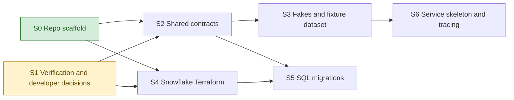

# Foundation roadmap

Everything the other ten features build against. It delivers the repo scaffold, the
answers to the spec's VERIFY items, the shared contracts (schemas, tool interfaces,
storage and job interfaces, the step clock, config), in-memory fakes with a synthetic
fixture dataset, the Snowflake objects and tables, and the four MCP servers running as
stubs.

**Why it exists:** the project is built contract-first. Once this feature is in `main`,
every other feature can be developed and tested in parallel against the contracts and
fakes, without waiting for a sibling feature, Snowflake data, the cluster or a paid API.
Keep it as small as that purpose allows: it is the only feature everything waits on.

**Architecture summary:** a `shared/` package holds the Pydantic schemas (one per table
and per tool payload), the typed interfaces (four tool servers, storage, job launcher,
run executor), the step clock and one config model. `shared/fakes/` implements every
interface in memory. Instrument types cover spot, futures and options from the start, so
the later derivative steps in other features add behaviour without changing contracts.

**Branch:** `foundation`, off `main`. **Needs in `main` first:** nothing.

**Critical path:** S0 -> S2 -> S3 -> S6. S1 runs beside S0; S4 and S5 run beside the
contract steps.

Spec: [project breakdown](../project-breakdown.md). All features: [docs/ROADMAP.md](../ROADMAP.md).

## Dependency graph

Progress (2026-11-10): S0 done. S1 is ready; S2 and S4 wait on S1.

## Dependency table

"In `main`" entries are other features that must be merged before the step can start.

| Step | Depends on | Can run in parallel with | Main files touched |
| --- | --- | --- | --- |
| S0 Repo scaffold | none | S1 | `requirements.txt`, `.env.example`, `CLAUDE.md`, `README.md`, `.github/workflows/`, package folders, `tests/` |
| S1 Verification and developer decisions | none | S0 | `docs/verification.md`, `docs/assumptions.md`, `docs/DECISIONS.md` |
| S2 Shared contracts | S0, S1 | S4 | `shared/schemas/`, `shared/interfaces/`, `shared/clock.py`, `shared/config.py` |
| S3 Fakes and fixture dataset | S2 | S4, S5 | `shared/fakes/`, `tests/fixtures/` |
| S4 Snowflake Terraform | S0, S1 | S2, S3, S6 | `infra/terraform/snowflake/` |
| S5 SQL migrations | S2, S4 | S3, S6 | `infra/sql/migrations/`, `scripts/migrate.py` |
| S6 Service skeleton and tracing | S3 | S4, S5 | `mcp_servers/common/`, `mcp_servers/*/__main__.py`, `shared/tracing.py` |

## Steps

| Step | Status | File | Summary |
| --- | --- | --- | --- |
| S0 Repo scaffold | done | [S00-repo-scaffold.md](S00-repo-scaffold.md) | Spec layout as importable packages, a Python 3.12 conda env with every spec-named dependency pinned, pytest with paid tests skipped by default, a Linux CI job for lint and tests, the project CLAUDE.md, a short README and three docs topic files. |
| S1 Verification and developer decisions | todo | [S01-verification-and-decisions.md](S01-verification-and-decisions.md) | Every VERIFY item that shapes a shared contract checked against official documentation, and the developer decisions from the spec settled and logged. |
| S2 Shared contracts | todo | [S02-shared-contracts.md](S02-shared-contracts.md) | Pydantic schemas for every table and tool payload, typed interfaces for the four tool servers, storage, job launching and run execution, the shared step clock and one config model. |
| S3 Fakes and fixture dataset | todo | [S03-fakes-and-fixture-dataset.md](S03-fakes-and-fixture-dataset.md) | In-memory implementations of every interface, scripted fake LLM and Jev responders, and a small deterministic synthetic dataset, so each feature can be tested without Snowflake, the cluster or paid APIs. |
| S4 Snowflake Terraform | todo | [S04-snowflake-terraform.md](S04-snowflake-terraform.md) | A Terraform module creating the database, the six schemas, the extra-small warehouse, the three roles with their grants and the service users. |
| S5 SQL migrations | todo | [S05-sql-migrations.md](S05-sql-migrations.md) | Versioned SQL migrations for all sixteen tables matching the shared schemas, a runner that applies them, and a check that the agent role cannot read the asset key. |
| S6 Service skeleton and tracing | todo | [S06-service-skeleton-and-tracing.md](S06-service-skeleton-and-tracing.md) | A shared MCP server factory over the verified HTTP transport, the four servers running as stubs on the fakes, an agent-side client check, and a tracing helper that does nothing when its keys are absent. |
