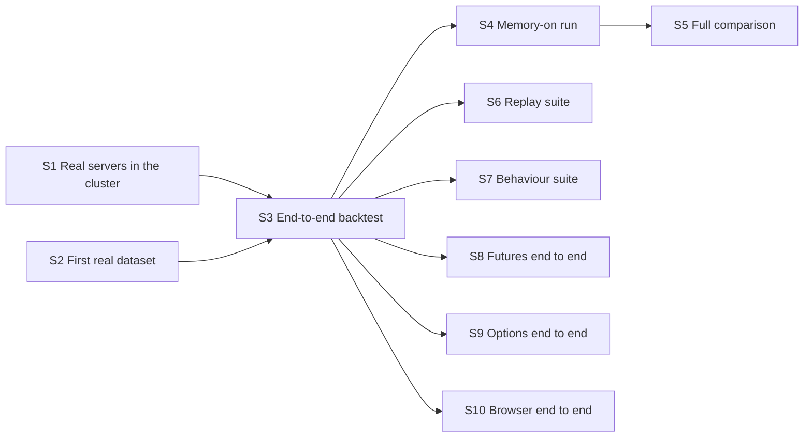

# Integration roadmap

Where the parallel features meet. Each was built against contracts and fakes; this
feature runs them together in the cluster on real data with real models and proves the
'done when' lines of the spec's build phases.

**Why it is last, and why it still parallelises:** each step needs only some features in
`main` (listed in the dependency table), so it can start before every feature has
landed. S1 and S2 start together; once the first real backtest (S3) works, six steps fan
out.

**Architecture summary:** nothing new is designed here. Work found to be missing in a
subsystem is fixed in this feature's branch, noted in the step file and logged in
`docs/DECISIONS.md` under the owning feature's heading.

**Branch:** `integration`, off `main`. **Needs in `main` first:** per step, see the
dependency table.

Steps here make real model calls and cluster deploys: both need the author's explicit
go-ahead in that session, and S8 and S9 need paid market data.

Spec: [project breakdown](../project-breakdown.md). All features: [docs/ROADMAP.md](../ROADMAP.md).

## Dependency graph

Progress (2026-11-10): nothing done and nothing ready. Ready as soon as the features they need are in `main`: S1, S2.

## Dependency table

"In `main`" entries are other features that must be merged before the step can start.

| Step | Depends on | Can run in parallel with | Main files touched |
| --- | --- | --- | --- |
| S1 Real servers in the cluster | none; in `main`: platform, market-data, broker-sim, memory, jev-decision | S2 | `infra/terraform/kubernetes/`, `tests/integration/` |
| S2 First real dataset | none; in `main`: platform, dataset-builder | S1 | `scripts/`, `docs/evaluation.md` |
| S3 End-to-end backtest | S1, S2; in `main`: agent | none | `tests/integration/`, `agent/` (fixes only) |
| S4 Memory-on run | S3 | S6, S7, S8, S9, S10 | `tests/integration/` |
| S5 Full comparison | S4; in `main`: evaluation | S6, S7, S8, S9, S10 | `eval/` (fixes only), `docs/evaluation.md` |
| S6 Replay suite | S3 | S4, S5, S7, S8, S9, S10 | `tests/replay/`, `.github/workflows/` |
| S7 Behaviour suite | S3 | S4, S5, S6, S8, S9, S10 | `tests/behavior/` |
| S8 Futures end to end | S3 | S4, S5, S6, S7, S9, S10 | `tests/integration/` |
| S9 Options end to end | S3 | S4, S5, S6, S7, S8, S10 | `tests/integration/` |
| S10 Browser end to end | S3; in `main`: web-app | S4, S5, S6, S7, S8, S9 | `infra/docker/`, `infra/terraform/kubernetes/`, `web/` (fixes only) |

## Steps

| Step | Status | File | Summary |
| --- | --- | --- | --- |
| S1 Real servers in the cluster | todo | [S01-real-servers-in-the-cluster.md](S01-real-servers-in-the-cluster.md) | The four real servers deployed in place of the stubs, with every tool answering in the cluster against Snowflake. |
| S2 First real dataset | todo | [S02-first-real-dataset.md](S02-first-real-dataset.md) | A five-asset dataset of four liquid US stocks or funds and one crypto asset built end to end as a cluster Job. |
| S3 End-to-end backtest | todo | [S03-end-to-end-backtest.md](S03-end-to-end-backtest.md) | A five-day memory-off backtest run as a cluster Job with real models, a trace for every full evaluation, a working resume and a clean masking scan. |
| S4 Memory-on run | todo | [S04-memory-on-run.md](S04-memory-on-run.md) | A development-period run that builds memory and a seeded memory-on run, with every no-lookahead rule tested on the real stack. |
| S5 Full comparison | todo | [S05-full-comparison.md](S05-full-comparison.md) | One command producing the four-variant, three-seed comparison on the test period, stored in the evaluation tables and as LangSmith experiments. |
| S6 Replay suite | todo | [S06-replay-suite.md](S06-replay-suite.md) | About thirty recorded scenarios replayed through the graph in CI, asserting that tool calls, stored records and orders are unchanged. |
| S7 Behaviour suite | todo | [S07-behaviour-suite.md](S07-behaviour-suite.md) | A LangSmith dataset of fixed situations with expected behaviour, and a five-day real-model backtest checked against stored baseline ranges, both run by hand. |
| S8 Futures end to end | todo | [S08-futures-end-to-end.md](S08-futures-end-to-end.md) | A dataset with micro futures on which the agent proposes, sizes and trades futures in a full run. |
| S9 Options end to end | todo | [S09-options-end-to-end.md](S09-options-end-to-end.md) | A dataset with option quotes on which the agent buys and sells single calls and puts in a full run. |
| S10 Browser end to end | todo | [S10-browser-end-to-end.md](S10-browser-end-to-end.md) | The API and web app deployed in the cluster, with a dataset built and a run started and watched entirely from the browser. |
