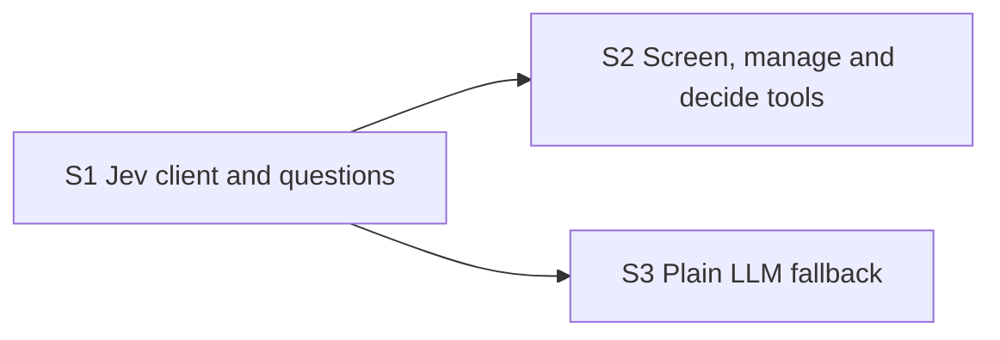

# Jev decision server roadmap

The `jev-decision` MCP server (spec sections 10.4 and 11): the only place that talks to
the Jev API.

**Why it can run in parallel:** it replaces the stub from foundation behind the same
interface. Tests replay recorded Jev responses, so no paid call is needed.

**Architecture summary:** Jev answers choice, score and yes/no questions with
probabilities; it cannot return a free number. The server turns agent state into those
questions and returns the probabilities. Turning probabilities into a dollar size is
plain code on the agent side (decision PRJ-004). All Jev-specific code stays here so a
plain LLM can replace it.

**Branch:** `jev-decision`, off `main`. **Needs in `main` first:** foundation.

Spec: [project breakdown](../project-breakdown.md). All features: [docs/ROADMAP.md](../ROADMAP.md).

## Dependency graph

Progress (2026-11-10): nothing done and nothing ready. Ready the moment foundation is merged into `main`: S1.

## Dependency table

"In `main`" entries are other features that must be merged before the step can start.

| Step | Depends on | Can run in parallel with | Main files touched |
| --- | --- | --- | --- |
| S1 Jev client and questions | none | none | `mcp_servers/jev_decision/client.py`, `mcp_servers/jev_decision/questions.py` |
| S2 Screen, manage and decide tools | S1 | S3 | `mcp_servers/jev_decision/tools.py` |
| S3 Plain LLM fallback | S1 | S2 | `mcp_servers/jev_decision/fallback.py` |

## Steps

| Step | Status | File | Summary |
| --- | --- | --- | --- |
| S1 Jev client and questions | todo | [S01-jev-client-and-questions.md](S01-jev-client-and-questions.md) | A Jev API client and builders that turn agent state into choice, score and yes/no questions and parse the returned probabilities, tested on recorded responses. |
| S2 Screen, manage and decide tools | todo | [S02-screen-manage-and-decide-tools.md](S02-screen-manage-and-decide-tools.md) | The screen, manage and decide tools returning each choice with per-option probabilities, conviction and the relevance answer, with latency, retries and cost recorded per call. |
| S3 Plain LLM fallback | todo | [S03-plain-llm-fallback.md](S03-plain-llm-fallback.md) | A plain LLM implementation behind the same three tools, switchable by config, so Jev can be replaced without touching the agent. |
