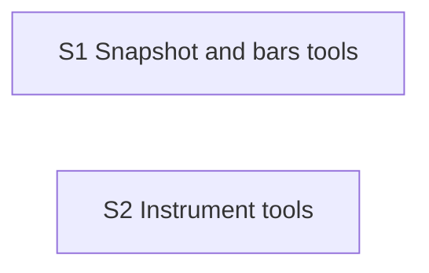

# Market-data server roadmap

The `market-data` MCP server (spec section 10.1): four read-only tools over a published
dataset, using masked IDs only.

**Why it can run in parallel:** it replaces the stub from foundation behind the same
interface and reads tables whose shape is fixed. It is developed against the fixture
dataset.

**Architecture summary:** a Snowflake reader behind the foundation's storage interface,
and tool handlers on top. The one hard rule lives in the server, not in the agent:
nothing after `step_id` is ever returned (spec section 13.6, rule 4).

**Branch:** `market-data`, off `main`. **Needs in `main` first:** foundation.

Shared file inside this feature: the server entry file, where both steps register tools.

Spec: [project breakdown](../project-breakdown.md). All features: [docs/ROADMAP.md](../ROADMAP.md).

## Dependency graph

Progress (2026-11-10): nothing done and nothing ready. Ready the moment foundation is merged into `main`: S1, S2.

## Dependency table

"In `main`" entries are other features that must be merged before the step can start.

| Step | Depends on | Can run in parallel with | Main files touched |
| --- | --- | --- | --- |
| S1 Snapshot and bars tools | none | S2 | `mcp_servers/market_data/store.py`, `mcp_servers/market_data/bars.py` |
| S2 Instrument tools | none | S1 | `mcp_servers/market_data/instruments.py` |

## Steps

| Step | Status | File | Summary |
| --- | --- | --- | --- |
| S1 Snapshot and bars tools | todo | [S01-snapshot-and-bars-tools.md](S01-snapshot-and-bars-tools.md) | Snapshot and recent-bars tools reading a published dataset from Snowflake, with the never-after-this-step rule enforced in the server and tested. |
| S2 Instrument tools | todo | [S02-instrument-tools.md](S02-instrument-tools.md) | Instrument listing and detail for spot, futures contracts and a shortlist of option contracts with strike, expiry, bid, ask and Greeks, all as of the step. |
