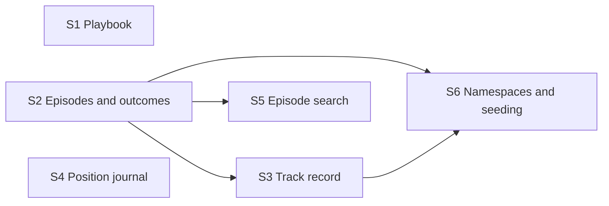

# Memory server roadmap

The `memory` MCP server (spec sections 10.3 and 13): the four kinds of long-term memory
in Snowflake, and the supporting question of the project, whether memory makes money.

**Why it can run in parallel:** it replaces the stub from foundation behind the same
interface and owns the `MEMORY` tables alone.

**Architecture summary:** no model writes into memory except the reasoning saved with a
decision, which is never retrieved as evidence. The playbook is shared reference text;
episodes, outcomes, the track record and journals are facts written by code and scoped
to a run's namespace. The no-lookahead rules (spec section 13.6) are enforced in the
server: only earlier episodes, only outcomes already visible, only trades already
closed.

**Branch:** `memory`, off `main`. **Needs in `main` first:** foundation.

Shared file inside this feature: the server entry file, where each step registers tools.

Spec: [project breakdown](../project-breakdown.md). All features: [docs/ROADMAP.md](../ROADMAP.md).

## Dependency graph

Progress (2026-11-10): nothing done and nothing ready. Ready the moment foundation is merged into `main`: S1, S2, S4.

## Dependency table

"In `main`" entries are other features that must be merged before the step can start.

| Step | Depends on | Can run in parallel with | Main files touched |
| --- | --- | --- | --- |
| S1 Playbook | none | S2, S3, S4, S5, S6 | `playbook/seed.csv`, `mcp_servers/memory/playbook.py` |
| S2 Episodes and outcomes | none | S1, S4 | `mcp_servers/memory/episodes.py`, `mcp_servers/memory/outcomes.py` |
| S3 Track record | S2 | S1, S4, S5 | `mcp_servers/memory/track_record.py` |
| S4 Position journal | none | S1, S2, S3, S5, S6 | `mcp_servers/memory/journal.py` |
| S5 Episode search | S2 | S1, S3, S4, S6 | `mcp_servers/memory/search.py` |
| S6 Namespaces and seeding | S2, S3 | S1, S4, S5 | `mcp_servers/memory/namespaces.py` |

## Steps

| Step | Status | File | Summary |
| --- | --- | --- | --- |
| S1 Playbook | todo | [S01-playbook.md](S01-playbook.md) | The pattern playbook seeded from the spec table, with opposite versions as separate entries, and a lookup that returns only the requested patterns. |
| S2 Episodes and outcomes | todo | [S02-episodes-and-outcomes.md](S02-episodes-and-outcomes.md) | Decision episodes written at every step, and code-computed outcomes and direction checks stored with the step from which each becomes visible. |
| S3 Track record | todo | [S03-track-record.md](S03-track-record.md) | Per-group trade statistics updated on each closed trade, counted only up to the current step, hidden below ten trades and rendered as one plain sentence. |
| S4 Position journal | todo | [S04-position-journal.md](S04-position-journal.md) | A journal per open position holding entry, exit plan, running state and manage history, returned for all open positions and kept and linked to its episode on close. |
| S5 Episode search | todo | [S05-episode-search.md](S05-episode-search.md) | The RAG tool: numeric and text similarity over past episodes in Snowflake, merged into one ranking, limited to earlier steps and to outcomes already visible. |
| S6 Namespaces and seeding | todo | [S06-namespaces-and-seeding.md](S06-namespaces-and-seeding.md) | A separate memory namespace per run with tested isolation, and starting a run from a copy of another run's episodes and track record. |
