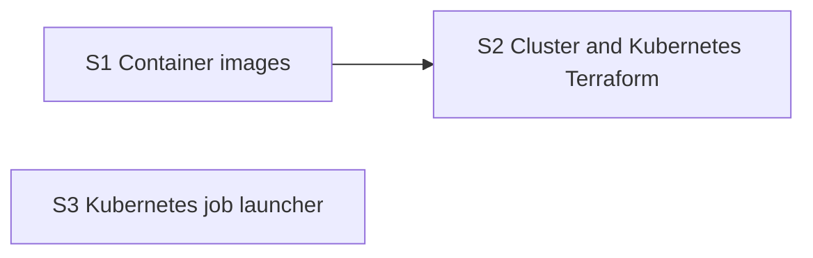

# Platform roadmap

The runtime the project is required to use: Docker images, a local kind cluster, the
Terraform `kubernetes` module and the code that starts Jobs on demand
(spec sections 14.2 and 14.3).

**Why it can run in parallel:** it deploys the stub servers from foundation, so it needs
no finished subsystem. The real servers are swapped in during integration.

**Architecture summary:** one base image carries Python and TA-Lib; each service and job
is a thin image on top. Terraform manages the `trading-agent` namespace, Secrets, the
`agent-config` ConfigMap, Deployments and Services, and a ServiceAccount whose Role can
only create, read and delete Jobs in that namespace. The job launcher implements the
foundation's launcher interface for `dataset-build-<dataset_id>` and `backtest-<run_id>`.

**Branch:** `platform`, off `main`. **Needs in `main` first:** foundation.

Every `kind`, `terraform apply` and `kubectl apply` run is a deploy and needs the
author's explicit go-ahead in that session.

Spec: [project breakdown](../project-breakdown.md). All features: [docs/ROADMAP.md](../ROADMAP.md).

## Dependency graph

Progress (2026-11-10): nothing done and nothing ready. Ready the moment foundation is merged into `main`: S1, S3.

## Dependency table

"In `main`" entries are other features that must be merged before the step can start.

| Step | Depends on | Can run in parallel with | Main files touched |
| --- | --- | --- | --- |
| S1 Container images | none | S3 | `infra/docker/`, `scripts/build_images.py` |
| S2 Cluster and Kubernetes Terraform | S1 | S3 | `infra/terraform/kubernetes/`, `scripts/cluster.py` |
| S3 Kubernetes job launcher | none | S1, S2 | `jobs/launcher.py`, `jobs/manifests.py` |

## Steps

| Step | Status | File | Summary |
| --- | --- | --- | --- |
| S1 Container images | todo | [S01-container-images.md](S01-container-images.md) | A base Python image with TA-Lib and one image per service and job, built and loaded into kind by one cross-platform script. |
| S2 Cluster and Kubernetes Terraform | todo | [S02-cluster-and-kubernetes-terraform.md](S02-cluster-and-kubernetes-terraform.md) | kind cluster creation and a Terraform module for the namespace, Secrets, the agent ConfigMap, the server and API Deployments with Services, and the Job-only ServiceAccount and Role, with stub servers answering in the cluster. |
| S3 Kubernetes job launcher | todo | [S03-kubernetes-job-launcher.md](S03-kubernetes-job-launcher.md) | The real job launcher that creates, reads, stops and deletes dataset-build and backtest Jobs in the namespace, with a command-line entry. |
