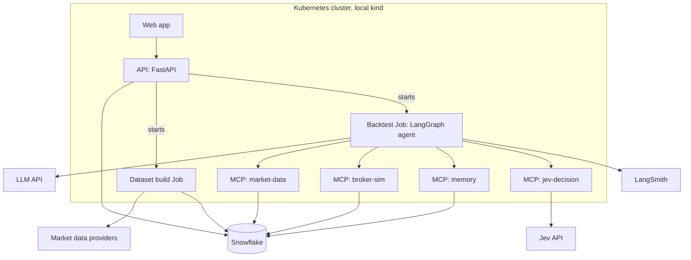

# Trading Agent with Memory (Simulation)

## 1. Purpose

Build an agent that trades stocks, crypto, short positions, futures, and options in a historical market simulation. Every 15 minutes it may act or do nothing. It records every decision and uses those records, plus a reference playbook of candle patterns, to trade better over time.

**Main goal: net profit in dollars, after all trading costs, on a period the agent never saw during development.**

Supporting question: does the agent with memory make more money than the same agent without memory?

The project has two user-facing parts, both reached through one web app:

1. **Dataset builder:** choose assets and a date range, and build a simulation dataset.
2. **Runs and dashboard:** start a run on a dataset, watch it play out live, and analyze the results.

This is a solo project. It must run on one developer machine plus one small Snowflake account and a few hosted services. No real orders are ever placed.

## 2. Notes for the coding agent

- The developer works on Windows using CMD. All commands, scripts, and docs must work in CMD. No bash-only syntax.
- The primary language is Python. The web app frontend is the exception (section 18).
- **Technology rule:** when a technology is not specified in this file, choose the one most in demand in agentic engineer job postings, and say which one you chose and why.
- Items marked **VERIFY** must be checked against current official documentation before you write code that depends on them.
- Section 6 lists assumptions made on the developer's behalf. Treat them as defaults, not fixed requirements.
- Never commit secrets.

## 3. Glossary

| Term | Meaning |
|---|---|
| LLM | Large language model. |
| MCP | Model Context Protocol. The standard for exposing tools to an LLM. |
| RAG | Retrieval-augmented generation. The agent searches stored records before deciding. |
| LangGraph | Framework for building agents as a graph of steps with shared state. |
| LangSmith | Hosted platform for tracing, evaluating, and monitoring LLM applications. |
| Jev | Hosted decision model from TypeSafe AI. State goes in; choice, score, and yes/no answers with probabilities come out. |
| kind | Kubernetes in Docker. Runs a local cluster. |
| Bar | One 15-minute candle: open, high, low, close, volume. |
| Step | One 15-minute decision point on a shared clock. US stocks have 26 per trading day; crypto has 96 per day. |
| Dataset | A fixed, versioned set of assets, instruments, bars, and candle features that runs are executed on. |
| Masked ID | The neutral name the agent sees for an asset, such as `ASSET_03`. |
| Asset key | The table that maps each masked ID back to the real asset. Never visible to the agent. |
| Playbook | Reference entries describing what each candle pattern traditionally means. |
| Track record | Statistics, computed by code, of how the agent's own trades have performed for each pattern and context. |
| Episode | One past decision with its situation, action, and outcome. |
| Position journal | The running record for an open position: why it was opened, the exit plan, and what has happened since. |
| TA-Lib | Open source technical analysis library with candle pattern detection. |
| ATR | Average True Range. A measure of how much price moves per bar. |
| VWAP | Volume Weighted Average Price. The average price paid during the day, weighted by volume. |
| Greeks | Standard measures of how an option's price reacts to changes in price, time, and volatility. |
| Margin | Cash that must be set aside to hold a short, futures, or leveraged position. |
| Spot | Buying or selling the asset itself, as opposed to a futures or options contract on it. |
| CI | Continuous integration. Tests that run automatically on every code change. |

## 4. Requirements

| Requirement | Role in this project |
|---|---|
| Kubernetes | Runs the MCP servers, dataset build jobs, backtest jobs, the API, and the web app. The API starts jobs on demand. |
| Agentic | A LangGraph agent runs an observe, retrieve, propose, decide, act loop at every step. |
| Terraform | Creates the Snowflake objects, roles, and the Kubernetes resources. |
| Custom MCP servers | Four servers written for this project (section 10). |
| Snowflake | Stores datasets, candle features, memory, simulation results, and evaluation results. |
| Tool-calling | The LLM reaches data, memory, the broker, and Jev through MCP tools. |
| RAG tool for memory | `memory.search` returns similar past episodes and how they turned out. |
| Long-term memory in database | Playbook, track record, episodes, and position journals persist in Snowflake. |
| Dataset creation | Section 8. Built first. |
| Evaluation harness | Section 17. |
| Observability and traceability | LangSmith, section 15. |
| Regression tests | Section 16. |
| Web app | Section 18. Built last, using the `/editorial-ui` skill. |

## 5. Technology choices

| Area                            | Choice                                                                         | Why                                                               |
| ------------------------------- | ------------------------------------------------------------------------------ | ----------------------------------------------------------------- |
| Orchestration                   | LangGraph                                                                      | Most requested agent framework in job postings.                   |
| Tracing, monitoring, evaluation | LangSmith                                                                      | Named most often in postings; integrates directly with LangGraph. |
| Tool protocol                   | MCP, official Python SDK                                                       | Required.                                                         |
| MCP to LangGraph bridge         | LangChain MCP adapters                                                         | **VERIFY** current package name and usage.                        |
| Decision model                  | Jev (TypeSafe AI)                                                              | Chosen by the developer.                                          |
| LLM                             | Configurable through LangChain's model interface                               | Provider chosen at build time (section 22).                       |
| Data validation                 | Pydantic                                                                       | Standard in the Python LLM ecosystem.                             |
| Candle pattern detection        | TA-Lib plus a little custom code                                               | Standard library, about 60 named patterns.                        |
| Data handling                   | pandas                                                                         | Standard.                                                         |
| Database and vector search      | Snowflake                                                                      | Required.                                                         |
| Infrastructure                  | Terraform, Docker, kind                                                        | Required or standard.                                             |
| Tests                           | pytest                                                                         | Standard.                                                         |
| CI                              | GitHub Actions                                                                 | Most common.                                                      |
| Backend API                     | FastAPI                                                                        | Most requested Python API framework.                              |
| Frontend                        | Whatever `/editorial-ui` specifies. If it does not specify, ask the developer. | Developer's skill decides.                                        |

## 6. Assumptions (defaults chosen for the developer; change any of them)

| # | Assumption |
|---|---|
| 1 | Simulation only. There is no live or paper trading against a real market. The broker code is isolated so one could be added later. |
| 2 | A "live run" means a historical replay that you start from the web app and watch as it progresses. It runs as fast as the models allow, not at 15 real minutes per step. |
| 3 | Starting account value is $10,000 simulated. |
| 4 | Risk limits: 10% of account value per position, total exposure of 2 times account value, and no new trades for the rest of the day after losing 3%. |
| 5 | Positions may be held overnight and across days. The agent decides when to exit. |
| 6 | Every position has a stop price set at entry, and code closes the position if the stop is hit. The profit target is advisory only. |
| 7 | Stocks: long and short. US regular session only, 09:30 to 16:00 Eastern. |
| 8 | Crypto: spot long and short only, traded around the clock. No crypto futures or options in version 1. |
| 9 | Futures: micro contracts only, regular US session only. |
| 10 | Options: buying single calls and puts only. No selling options to open and no multi-leg trades. Expiry at least 7 days away at entry. |
| 11 | Asset names, dates, and price levels are masked before anything reaches a model. The web app shows the real names using the asset key. |
| 12 | Data comes from official data provider APIs, not from scraping web pages. Stock data can be free; option and futures data will likely cost money, which is why they come late in the build order. |
| 13 | A track record group is shown to the agent only after it has at least 10 closed trades. |
| 14 | The LLM does not write lessons or rules. Learning comes from factual records and computed statistics. |
| 15 | The app is for a single user on a local machine. There is no login system. |
| 16 | The LLM provider and model are not chosen yet (section 22). |

## 7. Architecture overview



## 8. Dataset builder (built first)

A standalone service that turns a list of chosen assets into a ready-to-run simulation dataset. It is usable from CMD from phase 1, and gets its screens in the web app in the final phase.

### 8.1 What the user chooses

| Input | Options |
|---|---|
| Assets | Any mix of stocks, funds, and crypto, searched by real name or ticker |
| Date range | Start and end dates |
| Instrument types | Spot only, or also futures and options where the asset has them and the data source is configured |
| Split | Which part of the range is the development period and which is the test period |

### 8.2 What a build job does

1. **Download** 15-minute bars for each asset from the configured provider. For options, download quotes for a filtered set of contracts. For futures, download the front contracts.
2. **Validate:** check for missing bars, duplicate bars, zero volume gaps, and price jumps caused by stock splits. Adjust for splits. Record a quality report.
3. **Build the instrument list:** one row per tradable instrument with its type, multiplier, margin, strike, and expiry.
4. **Mask:** assign each asset a masked ID in random order, replace dates with day numbers, and rescale prices so each series starts at 100. Write the mapping and the scale factors to the asset key.
5. **Compute candle features** for every bar (section 12).
6. **Publish** the dataset under a new `dataset_id`. A published dataset never changes.

### 8.3 Rules

- Each build runs as a Kubernetes Job started by the API.
- A dataset is immutable. Changing the asset list creates a new dataset.
- Every run references exactly one `dataset_id`.
- Use official provider APIs and respect their rate limits and license terms. Do not scrape web pages.
- Provider access is behind one small interface per asset class so providers can be swapped.

### 8.4 Candidate providers

| Asset class | Candidate | Notes |
|---|---|---|
| Stocks and funds | Alpaca | Free tier with minute bars |
| Crypto | A major exchange's public market data API | Free. **VERIFY** which is accessible from the developer's region and its terms |
| Options | Massive (formerly Polygon.io) | Paid plans |
| Futures | Databento | Pay per use |

**VERIFY** current pricing, history depth, and license terms for each.

## 9. Agent loop

### 9.1 Timing

- All assets share one clock of 15-minute steps.
- An asset can only be traded at steps when its market is open. Stocks, futures, and options have 26 steps per trading day. Crypto has 96 steps per day.
- The agent decides at the close of a bar. Orders fill at the open of the next bar, with costs applied.

### 9.2 Three tiers per step (cost control)

| Tier | Runs | Does what |
|---|---|---|
| 0: Code | Every step, every asset | Updates the portfolio, enforces stop prices and risk limits, settles closed trades, updates the track record. |
| 1: Jev only | Every step, every asset | For an asset with no position: one yes/no screen, "Is this worth a full evaluation right now?" For an open position: `jev.manage` chooses hold, close, reduce, or add. |
| 2: Full evaluation | Only when triggered | The LLM proposes candidate trades, Jev picks one and sizes it. |

Tier 2 is triggered when a candle pattern fired, when the Tier 1 screen says yes, or when `manage` answers "add".

Every step is logged as a decision, including "no action" and the tier where it stopped.

### 9.3 LangGraph nodes for a full evaluation

1. **observe:** call `market_data.get_snapshot` for candle patterns, geometry, and context.
2. **retrieve:** gather the four kinds of memory (section 13): playbook entries for the patterns that fired, the track record for this pattern and context, similar past episodes through `memory.search`, and all open positions. With memory off, only open positions are included.
3. **propose:** the LLM uses tools to look at instruments and drafts up to 5 fully specified candidate trades, each with instrument, direction, stop price, target price, and a one-sentence reason. It may propose none.
4. **decide:** call `jev.decide` to pick a candidate or "no trade", and to choose the dollar size (section 11).
5. **gate:** plain Python checks risk limits. Code has the final say.
6. **act:** call `broker.place_order`.
7. **record:** call `memory.write_decision`. If a position was opened, start its position journal.

### 9.4 Division of labor

| Part | Responsibility |
|---|---|
| LLM | Proposes candidate trades with a stop, a target, and a reason. |
| Jev | Screens steps, manages open positions, picks the trade, sizes it, rates conviction. |
| Python code | Detects candle patterns, enforces stops and limits, simulates fills, computes outcomes, tags, and the track record, advances the clock. |

### 9.5 Resuming

The job records the last completed step in Snowflake and resumes from there if restarted.

## 10. MCP servers

All four are custom and run as Kubernetes Deployments reachable over HTTP inside the cluster. **VERIFY** the current recommended HTTP transport in the MCP Python SDK. Every tool works only with masked IDs.

### 10.1 market-data

| Tool | Purpose |
|---|---|
| `get_snapshot(asset_id, step_id)` | Candle patterns, candle geometry, and context for that step. |
| `get_bars(asset_id, step_id, lookback)` | Recent bars up to and including that step. |
| `list_instruments(asset_id, step_id, type)` | Tradable instruments for an asset: spot, futures contracts, or a shortlist of option contracts with strike, expiry, bid, ask, and Greeks. |
| `get_instrument(instrument_id, step_id)` | Details for one instrument. |

Rule: never return data from after `step_id`.

### 10.2 broker-sim

| Tool | Purpose |
|---|---|
| `get_portfolio(run_id)` | Cash, buying power, margin used, open positions with unrealized profit or loss. |
| `place_order(run_id, instrument_id, side, dollars, stop_price, target_price, step_id)` | Converts dollars to whole units and fills at the next bar. |
| `close_position(run_id, instrument_id, fraction, step_id)` | Closes all or part of a position. |
| `get_trade_history(run_id)` | Past fills. |

Simulation rules:

| Instrument | Rules |
|---|---|
| Stock, long | Fill at next bar open plus slippage. Commission per trade. |
| Stock, short | Same, plus margin requirement and a daily borrow fee. |
| Crypto, long and short | Fractional units allowed. Trading fee as a percentage. Shorts pay a daily fee. |
| Futures | Micro contracts only. Contract multiplier, margin per contract, valued every step. Use the front contract and roll before expiry. |
| Options | Buy at the ask, sell at the bid. Expired contracts settle at their final value. |

Meaning of the dollar amount:

| Instrument | "Dollars" means |
|---|---|
| Stock or crypto | Value bought or sold short |
| Options | Premium paid, which is the most that can be lost |
| Futures | Margin committed; total exposure is checked against the leverage limit |

### 10.3 memory

| Tool | Called by | Purpose |
|---|---|---|
| `search(namespace, asset_id, step_id, situation, k)` | LLM | The RAG tool. Returns the k most similar past episodes with their outcomes and tags. |
| `get_playbook(patterns)` | Code | Returns the playbook entries for the named patterns. |
| `get_track_record(namespace, pattern, context, step_id)` | Code | Returns the agent's own statistics for that pattern and context. |
| `get_open_positions(run_id, step_id)` | Code and LLM | Returns every open position with its journal. |
| `write_decision(...)` | Code | Stores an episode. |
| `write_outcome(decision_id, ...)` | Code | Stores results and tags once known, and updates the track record. |
| `update_position(position_id, ...)` | Code | Appends to a position journal. |

### 10.4 jev-decision

| Tool | Purpose |
|---|---|
| `screen(state)` | Tier 1 yes/no screen. |
| `manage(state, position)` | For an open position: hold, close, reduce, or add. |
| `decide(state, candidates, size_buckets)` | Picks the trade and the size. |

Keep all Jev-specific code inside this server so it can be replaced by a plain LLM call if needed.

## 11. Jev decision and sizing

Jev cannot return a free number. Per its documentation it answers choice questions (up to 255 options, with a probability for each), score questions (2 to 10 ordered levels, fractional result), and yes/no questions. **VERIFY** these limits, the request format, the Python SDK, and pricing in the official TypeSafe documentation.

### 11.1 Questions sent in one `decide` call

| Question | Type | Options |
|---|---|---|
| `trade` | choice | Each candidate trade from the LLM, plus `no_trade` |
| `size_usd` | choice | Dollar buckets computed by code for this step |
| `conviction` | score | 5 levels, from very weak to very strong |
| `memories_relevant` | yes/no | Are the retrieved episodes relevant to this situation? |

### 11.2 Turning the answer into a dollar amount

Code builds the buckets from current account value, for example 1%, 2%, 4%, 6%, and 10%. On a $10,000 account that is $100, $200, $400, $600, and $1,000.

Jev returns a probability $p_i$ for each bucket $b_i$. The trade size is the probability-weighted average:

$$\text{size} = \sum_{i} p_i \, b_i$$

Code then rounds down to whole shares or contracts (crypto may be fractional) and clips the result to the risk limits. If the rounded size is zero units, no trade is placed.

### 11.3 What goes in the state

- Candle patterns and geometry for the asset, and its context
- Playbook entries for the patterns that fired
- Track record for those patterns in this context
- Similar past episodes with outcomes
- All open positions with their journals, and total exposure
- Cash, buying power, and current risk limits
- Each candidate trade with its instrument facts: type, multiplier, margin, expiry, quote, and Greeks for options

### 11.4 Questions in a `manage` call

| Question | Type | Options |
|---|---|---|
| `action` | choice | `hold`, `close`, `reduce_half`, `add` |
| `thesis_intact` | yes/no | Is the original reason for the trade still valid? |

The state for `manage` is the position journal plus the current snapshot.

## 12. Candle signals and playbook

Candle shapes are the primary signal. Context features sit around them, since candles alone are a weak signal.

### 12.1 Extraction, computed in code for every bar

| Group | Contents |
|---|---|
| Named patterns | The patterns in section 12.4. Each returns bullish, bearish, or none. |
| Candle geometry | For each of the last 8 bars: direction, body size as a share of the bar's range, upper and lower wick shares, range compared with ATR, gap from the previous close. |
| Context | Trend on 15-minute and daily bars, volume compared with normal for that time of day, distance from VWAP, distance from the day's high and low and the previous day's high and low, ATR, bar number within the day. |

Code also writes a one-paragraph plain-language description of each snapshot, for example: "Bullish engulfing after four falling bars, volume 1.8 times normal, price below VWAP, late morning." This text is embedded for memory search.

### 12.2 Where the theory lives

| Place | Contents | Sent to the models |
|---|---|---|
| System prompt | The short principles in section 12.3 | On every call |
| `MEMORY.PLAYBOOK` table | One entry per pattern, loaded from section 12.4 | Only the entries for patterns that fired at this step, looked up by name |

The full playbook is never placed in the system prompt.

### 12.3 Principles for the system prompt

1. A reversal pattern only means something if there is a prior move to reverse.
2. A pattern at an important level carries more weight: the day's high or low, the previous day's high or low, or VWAP.
3. Volume above normal strengthens a signal. Low volume weakens it.
4. A pattern is stronger once the next bar closes in the direction it signals.
5. Trades in the direction of the daily trend are more reliable than trades against it.
6. For stocks, the first and last 30 minutes of the day are more volatile, and midday signals are weaker.
7. Textbook meaning is a starting hypothesis. When your own track record has enough trades, it outweighs the textbook.
8. Doing nothing is always a valid decision.

### 12.4 Playbook seed data

Load these into `MEMORY.PLAYBOOK`. "Detector" is the TA-Lib function; **VERIFY** each name and its exact definition. Patterns with opposite versions are stored as two entries.

| Pattern | Shape | Traditional meaning | Context and confirmation | Detector |
|---|---|---|---|---|
| Doji | Open and close nearly equal, so almost no body | Indecision | Matters after a strong move. The next bar's direction decides it. | `CDLDOJI` |
| Dragonfly doji | Almost no body at the top, long lower wick | Sellers pushed down and were rejected. Bullish. | After a decline or at a low of the day. | `CDLDRAGONFLYDOJI` |
| Gravestone doji | Almost no body at the bottom, long upper wick | Buyers pushed up and were rejected. Bearish. | After an advance or at a high of the day. | `CDLGRAVESTONEDOJI` |
| Spinning top | Small body with wicks on both sides | Indecision, momentum fading | Weak alone. Useful as a warning after a long run. | `CDLSPINNINGTOP` |
| Marubozu | Long body with little or no wick | One side in full control. Continuation. | Up bar is bullish, down bar is bearish. Stronger on high volume. | `CDLMARUBOZU` |
| Hammer | Small body at the top, lower wick at least twice the body | Bullish reversal | Must follow a decline. Confirm with a higher close on the next bar. | `CDLHAMMER` |
| Hanging man | Same shape as a hammer | Bearish warning | Must follow an advance. Needs a lower close on the next bar. | `CDLHANGINGMAN` |
| Inverted hammer | Small body at the bottom, long upper wick | Possible bullish reversal | Must follow a decline. Weaker than a hammer; needs confirmation. | `CDLINVERTEDHAMMER` |
| Shooting star | Same shape as an inverted hammer | Bearish reversal | Must follow an advance. Stronger at a high of the day. | `CDLSHOOTINGSTAR` |
| Bullish engulfing | Up bar whose body fully covers the previous down bar's body | Bullish reversal | Must follow a decline. Stronger with high volume. | `CDLENGULFING` |
| Bearish engulfing | Down bar whose body fully covers the previous up bar's body | Bearish reversal | Must follow an advance. Stronger with high volume. | `CDLENGULFING` |
| Bullish harami | Small body inside the previous large down body | Selling is slowing | Weak alone. Wait for a bar that closes above the first bar. | `CDLHARAMI` |
| Bearish harami | Small body inside the previous large up body | Buying is slowing | Weak alone. Wait for a bar that closes below the first bar. | `CDLHARAMI` |
| Piercing line | Down bar, then an up bar that opens lower and closes above the middle of the first body | Bullish reversal | Must follow a decline. | `CDLPIERCING` |
| Dark cloud cover | Up bar, then a down bar that opens higher and closes below the middle of the first body | Bearish reversal | Must follow an advance. | `CDLDARKCLOUDCOVER` |
| Tweezer bottom | Two bars with nearly the same low | A price level was rejected twice. Bullish. | After a decline. | Custom code |
| Tweezer top | Two bars with nearly the same high | A price level was rejected twice. Bearish. | After an advance. | Custom code |
| Morning star | Large down bar, small-bodied bar, large up bar closing well into the first body | Bullish reversal | Must follow a decline. One of the stronger reversal patterns. | `CDLMORNINGSTAR` |
| Evening star | Large up bar, small-bodied bar, large down bar closing well into the first body | Bearish reversal | Must follow an advance. | `CDLEVENINGSTAR` |
| Three inside up or down | A harami followed by a third bar closing beyond the first bar | A confirmed harami reversal | Direction follows the third bar. | `CDL3INSIDE` |
| Three white soldiers | Three long up bars in a row, each closing near its high | Strong buying | After a long advance it can mean the move is stretched. | `CDL3WHITESOLDIERS` |
| Three black crows | Three long down bars in a row, each closing near its low | Strong selling | After a long decline it can mean the move is stretched. | `CDL3BLACKCROWS` |
| Rising or falling three methods | A long bar, three small bars against it that stay inside its range, then another long bar in the original direction | Continuation of the trend | Direction follows the long bars. | `CDLRISEFALL3METHODS` |

Note for intraday data: several classic definitions rely on a gap between bars. Gaps are rare between 15-minute bars inside a day, so those patterns will mostly appear at the open. Check how each detector behaves on 15-minute bars and document any definition you relax.

**VERIFY** TA-Lib installation on Windows and in the container image.

## 13. Memory design

No model writes anything into memory except the reasoning saved with a decision, and that reasoning is never retrieved as evidence. Everything the agent learns from is either reference text or facts computed by code.

### 13.1 The four kinds of memory

| Kind | What it holds | How the agent gets it |
|---|---|---|
| Playbook | Traditional meaning of each candle pattern (section 12.4) | Lookup by pattern name |
| Track record | The agent's own results for each pattern and context | Lookup by pattern and context |
| Episodes | Individual past decisions with outcomes and tags | RAG similarity search |
| Open positions | A journal for each position currently held | Always included |

### 13.2 Episodes

One record per decision, written at every step:

- Candle snapshot, feature vector, and situation text
- Tier reached, candidates, chosen trade, size, stop, and target
- Jev probabilities and conviction
- IDs of the memories that were shown
- The LLM's stated reason (kept for auditing in the web app only)
- Prompt version and LangSmith trace ID

Outcomes and tags are added by code as they become known:

| Field | Meaning |
|---|---|
| Realized profit or loss | Dollars and percent, after costs, when the position closes |
| Exit reason | Agent closed it, stop hit, daily loss limit, or option expired |
| Best and worst point | The largest gain and largest loss the trade reached before closing |
| Bars held | Number of steps the position was open |
| Direction check | Whether price moved the predicted way after 1 bar, 4 bars, and at the end of the day |

Direction checks are stored for "no trade" decisions as well, so missed moves are on record.

### 13.3 Track record

A table updated by code each time a trade closes.

- **Grouped by:** pattern, direction, instrument type, with or against the daily trend, high or low volume, and time-of-day bucket.
- **Holds:** number of trades, wins, win rate, average profit or loss, and total profit or loss.
- **Shown to the agent as:** "Bullish engulfing, against trend, low volume: 18 trades, 5 wins, average loss of $12."
- **Minimum sample:** a group is shown only once it has at least 10 closed trades. The trade count is always shown.

### 13.4 Open positions (position journal)

Created when a position opens and updated every step until it closes.

| Part | Contents |
|---|---|
| Entry | Instrument, direction, size, entry price, the patterns and context at entry, the LLM's reason, Jev probabilities |
| Exit plan | Stop price (enforced by code), target price (advisory), and the condition that would invalidate the trade |
| Running state | Unrealized profit or loss, best and worst point so far, bars held, distance to stop and target |
| History | Each `manage` decision with its step and probabilities, and any partial closes or adds |

The journal for a position is the main input to `jev.manage`. A summary of all open positions is included in every full evaluation so the agent knows its total exposure before adding more.

When a position closes, its journal is kept and linked to the episode.

### 13.5 How episode retrieval works

`memory.search` combines two kinds of similarity and merges the results:

1. **Numeric:** compare the normalized candle feature vector with those of past episodes.
2. **Text:** compare the embedded situation text with past situation texts.

Vectors are stored and searched in Snowflake. **VERIFY** the vector data type, similarity functions, and embedding functions available in the account's region.

### 13.6 No-lookahead rules (critical)

Enforced inside the servers, never left to the agent:

1. An episode is retrievable only if its `step_id` is earlier than the current step.
2. An outcome or tag is visible only if its `available_from_step` is at or before the current step.
3. The track record counts only trades that closed at or before the current step.
4. Market data tools never return anything after the current step.

### 13.7 Masking and the asset key

- The dataset builder assigns masked IDs, replaces dates with day numbers, and rescales prices (section 8.2). Time of day is kept, since it is a real signal.
- No news, company names, or sector labels are ever stored in the agent's data.
- The mapping lives in `REF.ASSET_KEY`. The Snowflake role used by the agent and the MCP servers has no access to it. Only the API's role can read it.
- The web app uses the key to show real names and real prices next to each masked ID.
- LangSmith traces contain masked IDs only.
- Where possible, use a test period that falls after the LLM's training cutoff.

### 13.8 Namespaces and seeding

- Every run has its own `memory_namespace`, so runs never share episodes or track records.
- A run may start from a copy of another run's memory (`seed_namespace`). This is how a test period run starts with what the agent learned during the development period.
- The playbook is shared by all runs and is read only.

## 14. Snowflake, Kubernetes, and Terraform

### 14.1 Snowflake

Database: `TRADING_AGENT`. Warehouse: extra small, auto-suspend after 60 seconds.

| Schema | Table | Contents |
|---|---|---|
| `REF` | `DATASETS` | dataset_id, name, asset count, step range, development and test split, quality report, status |
| `REF` | `ASSET_KEY` | dataset_id, asset_id, real symbol, real name, asset class, price scale factor, first real date. Restricted. |
| `REF` | `INSTRUMENTS` | dataset_id, instrument_id, asset_id, type, multiplier, margin, strike, expiry, call or put |
| `RAW` | `BARS_15M` | dataset_id, instrument_id, step_id, day_no, bar_in_day, open, high, low, close, volume |
| `RAW` | `OPTION_QUOTES_15M` | dataset_id, instrument_id, step_id, bid, ask, implied volatility, Greeks |
| `FEATURES` | `CANDLE_FEATURES` | dataset_id, asset_id, step_id, pattern flags, geometry, context, feature_vector, situation_text |
| `SIM` | `RUNS` | run_id, dataset_id, variant, step range, seed, prompt_version, config, status, last_completed_step |
| `SIM` | `TRADES` | trade_id, run_id, instrument_id, step_id, side, units, fill_price, costs |
| `SIM` | `PORTFOLIO_STEPS` | run_id, step_id, cash, margin_used, total_value |
| `MEMORY` | `PLAYBOOK` | pattern, direction, shape, meaning, context_notes |
| `MEMORY` | `DECISIONS` | Episodes, section 13.2 |
| `MEMORY` | `OUTCOMES` | decision_id, kind, values, available_from_step |
| `MEMORY` | `TRACK_RECORD` | memory_namespace, group keys, trades, wins, average and total profit or loss, as_of_step |
| `MEMORY` | `POSITION_JOURNAL` | position_id, run_id, entry, exit plan, running state, history, status |
| `EVAL` | `RUN_METRICS` | run_id, metric_name, metric_value |
| `EVAL` | `CALIBRATION` | run_id, bucket, mean_confidence, hit_rate, count |

Roles:

| Role | Can read | Can write |
|---|---|---|
| `AGENT_ROLE` (agent job and MCP servers) | Everything except `REF.ASSET_KEY` | `SIM`, `MEMORY` |
| `BUILDER_ROLE` (dataset build job) | `REF`, `RAW`, `FEATURES` | `REF`, `RAW`, `FEATURES` |
| `APP_ROLE` (API) | Everything | `REF.DATASETS`, `SIM.RUNS` |

### 14.2 Kubernetes

Local cluster: kind. Namespace: `trading-agent`.

| Kind | Name |
|---|---|
| Deployment | `mcp-market-data`, `mcp-broker-sim`, `mcp-memory`, `mcp-jev-decision` |
| Deployment | `api`, `web` |
| Job | `dataset-build-<dataset_id>`, started by the API |
| Job | `backtest-<run_id>`, started by the API |
| ServiceAccount and Role | Lets the `api` create, read, and delete Jobs in this namespace only |
| Secret | `snowflake-credentials` (one per role), `llm-api-key`, `jev-api-key`, `langsmith-api-key`, `data-provider-keys` |
| ConfigMap | `agent-config`: prompt version, risk limits, buckets, k, minimum sample |

### 14.3 Terraform

| Module | Manages |
|---|---|
| `snowflake` | Database, schemas, warehouse, the three roles and their grants, service users |
| `kubernetes` | Namespace, Secrets, ConfigMaps, Deployments, Services, ServiceAccount and Role |

Tables are created by SQL migration files that a setup job applies. State is stored locally. **VERIFY** the current official Snowflake Terraform provider.

```cmd
kind create cluster --name trading-agent
cd infra\terraform
terraform init
terraform apply
```

## 15. Observability and traceability (LangSmith)

- Every LangGraph run is traced to LangSmith. One trace per asset per step that reaches Tier 2; Tier 1 calls are grouped in one trace per step.
- Every trace carries metadata: `run_id`, `dataset_id`, `step_id`, `asset_id` (masked), `variant`, `prompt_version`.
- The LangSmith trace ID is saved on the episode in Snowflake, so any trade can be followed back to the playbook entries, track record, episodes, candidates, and probabilities behind it.
- Calls made inside the MCP servers (Jev, Snowflake) are traced as child steps. **VERIFY** how to pass trace context from the agent to the MCP servers.
- LangSmith's monitoring views cover latency, token use, cost, and error rates.
- Kubernetes health is checked with `kubectl` and container logs.

**VERIFY** LangSmith's free tier limits against the number of traces a backtest produces. Reduce tracing of Tier 1 calls if needed.

## 16. Regression tests

### 16.1 Code tests (pytest, run in CI on every change)

- Broker math for each instrument type: fills, costs, margin, short fees, futures multipliers, option expiry, stop prices.
- Dollar to unit conversion and rounding.
- Risk limits.
- Candle features and each pattern detector against hand-checked bars.
- Track record arithmetic and the minimum sample rule.
- Position journal updates.
- Playbook lookup returns only the requested patterns.
- Each no-lookahead rule.
- Memory namespace isolation and seeding.
- Dataset builder: gap detection, split adjustment, masking, and that a published dataset cannot be changed.
- Masking: no real symbol or name from the asset key appears in any model input, and `AGENT_ROLE` cannot read `REF.ASSET_KEY`.

### 16.2 Replay tests (run in CI on every change)

- About 30 fixed scenarios with recorded LLM and Jev responses.
- The graph is replayed against the recordings. Tests assert that tool calls, stored records, and orders are unchanged.

### 16.3 Behavior tests (LangSmith datasets, run manually)

- A LangSmith dataset of fixed situations with expected behavior, for example: never exceeds the position limit, proposes no trade when the daily loss stop is active, always sets a stop price, picks an option only when the expiry rule is met.
- A short fixed backtest (5 trading days) with real model calls. Fails if key metrics fall outside agreed ranges compared with the stored baseline.
- Run whenever a prompt, model, or retrieval setting changes.

## 17. Evaluation harness

### 17.1 Data split

Defined per dataset in the dataset builder.

| Period | Use |
|---|---|
| Development | Building, tuning prompts, tuning limits, and building up memory |
| Test | Final measurement only. Never used for tuning. |

### 17.2 Variants, same dataset and same test period

| Variant | Description |
|---|---|
| `buy_hold` | Buys the assets at the start and holds. |
| `pattern_rules` | Simple coded strategy that trades candle patterns with no LLM and no Jev. |
| `memory_off` | Full agent with open-position memory only. |
| `memory_on` | Full agent with all four kinds of memory, seeded from its development period run. |

Run agent variants with at least 3 seeds and report the spread.

### 17.3 Metrics

**Money (headline)**

- Net profit in dollars after trading costs: $P = V_{\text{end}} - V_{\text{start}}$
- Net profit after trading costs and model costs: $P_{\text{net}} = P - C_{\text{LLM}} - C_{\text{Jev}}$
- Return: $R = \frac{V_{\text{end}} - V_{\text{start}}}{V_{\text{start}}}$

**Risk**

- Maximum drawdown: $\text{MDD} = \max_{t} \frac{\text{Peak}_t - V_t}{\text{Peak}_t}$
- Sharpe ratio on step returns $r$: $S = \frac{\bar{r}}{\sigma_r}\sqrt{N}$, where $N$ is the number of steps per year
- Profit factor: $\text{PF} = \frac{\text{gross profits}}{\text{gross losses}}$

**Trading behavior**

- Win rate, average win, average loss, number of trades, average bars held
- Profit broken down by instrument type, asset class, candle pattern, and exit reason

**Jev calibration**

- Brier score: $\text{BS} = \frac{1}{N} \sum_{i=1}^{N} (p_i - o_i)^2$
- Confidence buckets against actual hit rate

**Learning**

- Profit per day over time, `memory_on` against `memory_off`
- Share of decisions where retrieved episodes were marked relevant
- How often the agent went against a negative track record, and what that cost

Results are written to `EVAL.RUN_METRICS` and `EVAL.CALIBRATION`, and logged as LangSmith experiments.

## 18. Web app (final step)

**Before writing any frontend code, invoke the `/editorial-ui` skill. It is the source of truth for layout, typography, components, and framework.** If it does not specify a framework, use React with TypeScript.

- Backend: the FastAPI service. It reads Snowflake, starts and stops Kubernetes Jobs, and links out to LangSmith traces.
- The app can create datasets and start, stop, and resume runs. It never places trades itself.
- Everywhere an asset appears, show the real name and the masked ID together, using the asset key. Show real prices by reversing the price scale factor.

### 18.1 Dataset builder screens

| Screen | Shows |
|---|---|
| Datasets | All datasets with assets, date range, status, and quality summary |
| New dataset | Asset search and selection across stocks and crypto, date range, instrument types, development and test split, and a "Build" button |
| Dataset detail | Build progress, quality report, the asset key, and a candle chart preview for each asset |

### 18.2 Run screens

| Screen | Shows |
|---|---|
| New run | Pick a dataset, period, variant, seed, starting cash, risk limits, and optional seed memory; "Start" button |
| Live run | Updates as the replay progresses: current step, account value chart, open positions with their journals, latest decisions and trades, model cost so far; "Stop" button |
| Runs | All runs with status, config, model cost, and duration |

The live run screen refreshes by polling the API every few seconds.

### 18.3 Analysis screens

| Screen | Shows |
|---|---|
| Overview | Account value over time for all variants, net profit, and headline metrics |
| Trades | Every trade with real asset name, instrument type, size, profit or loss, exit reason, and bars held; filters |
| Trade detail | Candle chart around the trade with entry, stop, target, and exit marked; patterns detected; playbook entries, track record, and episodes that were shown; candidates; Jev probabilities; the LLM's reason; the position journal; outcome and tags; link to the LangSmith trace |
| Learning | Profit per day over time, memory on against memory off |
| Patterns | The track record table: results by candle pattern, context, and instrument type, next to the playbook's traditional meaning |
| Calibration | Stated confidence against actual hit rate |
| Playbook | The playbook entries |

## 19. Build phases

| Phase | Deliverable | Done when |
|---|---|---|
| 0 | Repo scaffold, kind cluster, Terraform for Snowflake and roles, LangSmith project, CI skeleton | `terraform apply` works and CI runs an empty test suite |
| 1 | Dataset builder service and build job for stocks and crypto: download, validate, mask, asset key, candle features, publish. Driven from CMD through the API. | A dataset with 5 assets is built end to end and its tests pass |
| 2 | Playbook loaded. `market-data` and `broker-sim` servers for stocks and crypto, long and short, with stop prices and code tests. | Tools work in the cluster and tests pass |
| 3 | LangGraph loop with the three tiers, `memory_off`, position journal, LangSmith tracing | A 5-day backtest finishes and every Tier 2 decision has a trace |
| 4 | `jev-decision` server: screen, manage, decide, size | Sizes come from Jev and probabilities are stored |
| 5 | `memory` server: episodes with RAG search, computed outcomes and tags, track record, playbook lookup, seeding | `memory_on` runs end to end and no-lookahead tests pass |
| 6 | Evaluation harness and baseline variants | One command produces the full comparison on the test period |
| 7 | Replay and behavior regression suites in CI | Replay tests run on every change |
| 8 | Futures: builder support, instruments, broker rules | The agent can trade micro futures and tests pass |
| 9 | Options: builder support, quotes, instruments, broker rules | The agent can buy and sell single calls and puts and tests pass |
| 10 | Web app built with `/editorial-ui`: dataset builder screens, run screens with the live view, analysis screens | A dataset can be built and a run started and watched entirely from the browser |

## 20. Repository structure

```text
trading-agent/
  ARCHITECTURE.md
  agent/
    graph.py
    nodes/
    prompts/
    policy.py
    runner.py
  mcp_servers/
    market_data/
    broker_sim/
    memory/
    jev_decision/
  dataset_builder/
    providers/
    validate.py
    mask.py
    candles.py
    build.py
  playbook/
    seed.csv
  eval/
    run_eval.py
    metrics.py
    baselines/
  api/
  web/
  infra/
    terraform/
      snowflake/
      kubernetes/
    sql/
      migrations/
    docker/
  tests/
    unit/
    replay/
    behavior/
  .github/
    workflows/
  scripts/
```

## 21. Risks and guardrails

| Risk | Guardrail |
|---|---|
| Future data leaks into decisions | Rules in section 13.6, enforced in the servers and tested |
| LLM recognizes real history | Masking in section 13.7, role restrictions on the asset key, a test that scans model inputs, and a test period after the training cutoff |
| Tuning to the test period | Strict development and test split per dataset |
| Unrealistic fills inflate profit | Next-bar fills, slippage, commissions, option bid and ask, short fees, margin |
| Track record statistics are chance | Minimum sample of 10 and the trade count always shown |
| Bad source data | Validation and a quality report in every dataset build |
| Model costs exceed profit | Three-tier design, per-run call budget that stops the job, model costs subtracted in the metrics |
| Options and futures complexity | Built late, with a narrow version 1 scope |
| Jev API changes or pricing | All Jev code isolated in one server with a plain LLM fallback |
| Secrets leak | Kubernetes Secrets only, nothing in git |

## 22. Decisions and items to verify before coding

**Developer decisions**

1. Which LLM provider and model the agent uses.
2. Market data providers and budget (section 8.4).
3. Any changes to the assumptions in section 6.
4. Assets for the first dataset (default: 4 liquid large US stocks or index funds that also have active options, plus 1 major crypto asset).

**Verify**

1. Jev API format, Python SDK, question limits, rate limits, and pricing.
2. LangGraph, LangSmith, and LangChain MCP adapter versions and usage.
3. LangSmith free tier limits.
4. Snowflake vector type, similarity functions, and embedding functions.
5. Snowflake Terraform provider name and version.
6. MCP Python SDK HTTP transport.
7. TA-Lib installation on Windows and in containers, and each detector name in section 12.4.
8. Data provider pricing, history depth, rate limits, and license terms.
9. What the `/editorial-ui` skill specifies for the frontend.