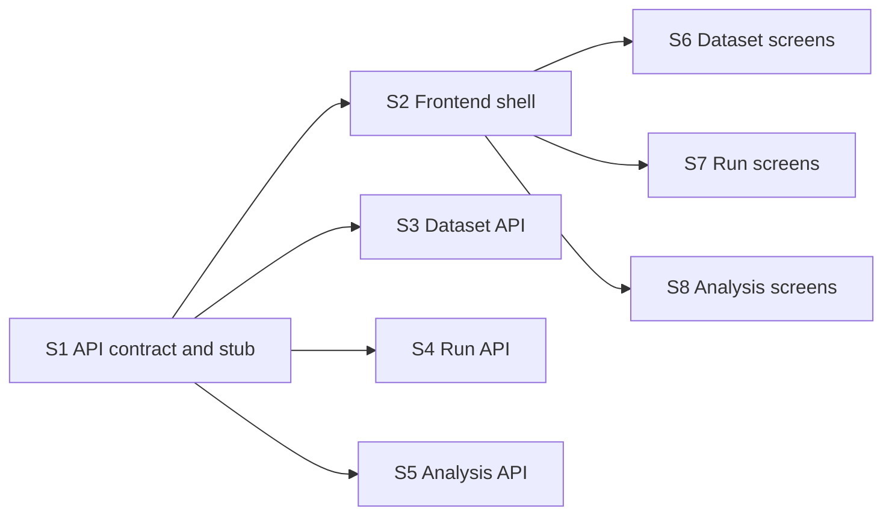

# Web app roadmap

The single web app through which both user-facing parts are reached (spec section 18):
build datasets, start and watch runs, analyse results. Single user, no login.

**Why it can run in parallel:** the first step fixes the API contract and serves it from
fixture data. From then on the backend and the frontend are two independent tracks, and
neither needs a finished subsystem: the API reads tables whose shape is fixed and starts
Jobs through the foundation's launcher interface.

**Architecture summary:** FastAPI is the only component that can read the asset key, so
it pairs every masked ID with the real name and converts masked prices back to real
ones. It reads Snowflake, starts and stops Jobs, and links to LangSmith traces; it never
places trades. The frontend follows the `editorial-ui` skill, which the spec names as the
source of truth; where the skill is silent the default is React with TypeScript. The
live run screen polls the API every few seconds.

**Branch:** `web-app`, off `main`. **Needs in `main` first:** foundation.

After S1, the API steps (S3 to S5) and the frontend shell (S2) start together; the three
screen steps follow S2 and run beside the API steps.

Spec: [project breakdown](../project-breakdown.md). All features: [docs/ROADMAP.md](../ROADMAP.md).

## Dependency graph

Progress (2026-11-10): nothing done and nothing ready. Ready the moment foundation is merged into `main`: S1.

## Dependency table

"In `main`" entries are other features that must be merged before the step can start.

| Step | Depends on | Can run in parallel with | Main files touched |
| --- | --- | --- | --- |
| S1 API contract and stub | none | none | `api/main.py`, `api/models.py`, `api/unmask.py`, `api/openapi.json` |
| S2 Frontend shell | S1 | S3, S4, S5 | `web/` (project config, layout, shared components, API client) |
| S3 Dataset API | S1 | S2, S4, S5, S6, S7, S8 | `api/routes/datasets.py` |
| S4 Run API | S1 | S2, S3, S5, S6, S7, S8 | `api/routes/runs.py` |
| S5 Analysis API | S1 | S2, S3, S4, S6, S7, S8 | `api/routes/analysis.py` |
| S6 Dataset screens | S2 | S3, S4, S5, S7, S8 | `web/src/datasets/` |
| S7 Run screens | S2 | S3, S4, S5, S6, S8 | `web/src/runs/` |
| S8 Analysis screens | S2 | S3, S4, S5, S6, S7 | `web/src/analysis/` |

## Steps

| Step | Status | File | Summary |
| --- | --- | --- | --- |
| S1 API contract and stub | todo | [S01-api-contract-and-stub.md](S01-api-contract-and-stub.md) | The FastAPI service with typed routes for every screen answering from fixture data, an exported OpenAPI file, and the helper that pairs masked IDs with real names and prices. |
| S2 Frontend shell | todo | [S02-frontend-shell.md](S02-frontend-shell.md) | The frontend project set up to the editorial-ui skill, with routing, a generated API client and the shared table, chart and candle components. |
| S3 Dataset API | todo | [S03-dataset-api.md](S03-dataset-api.md) | Dataset list and detail, asset search, and starting and following a build job. |
| S4 Run API | todo | [S04-run-api.md](S04-run-api.md) | Creating, starting, stopping and resuming runs as jobs, the run list, and the live-run data polled by the app. |
| S5 Analysis API | todo | [S05-analysis-api.md](S05-analysis-api.md) | Overview, trades, trade detail, learning, patterns, calibration and playbook data with real names and a link to each LangSmith trace. |
| S6 Dataset screens | todo | [S06-dataset-screens.md](S06-dataset-screens.md) | The datasets list, the new-dataset form with asset search, and dataset detail with build progress, quality report, asset key and a candle preview. |
| S7 Run screens | todo | [S07-run-screens.md](S07-run-screens.md) | The new-run form, the polling live-run view with value chart, positions and journals, decisions, trades and cost, and the runs list. |
| S8 Analysis screens | todo | [S08-analysis-screens.md](S08-analysis-screens.md) | The overview, trades, trade detail, learning, patterns, calibration and playbook views. |
